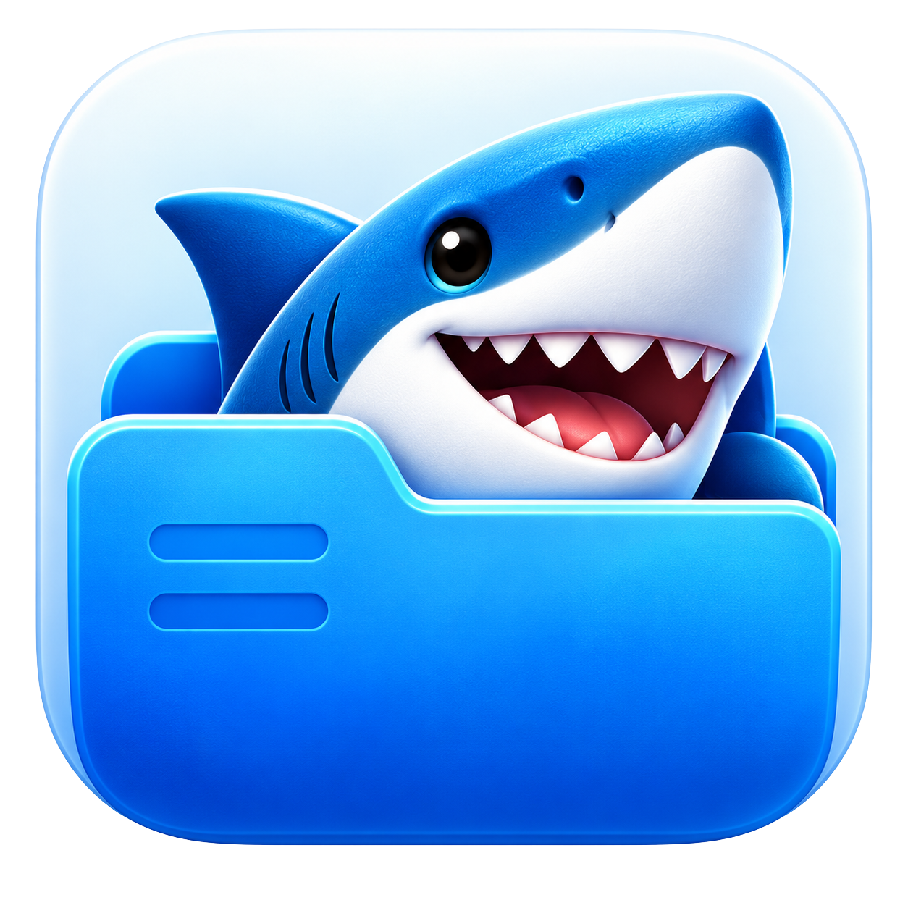
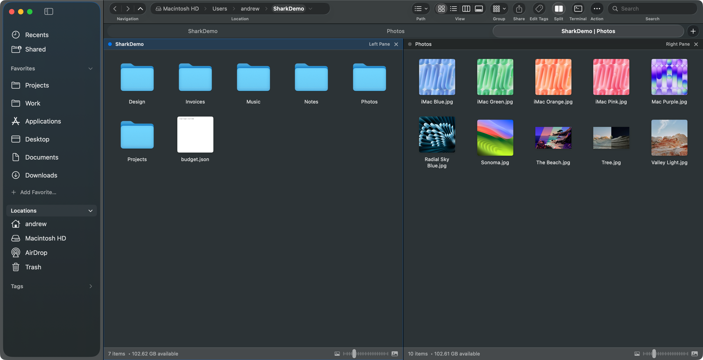
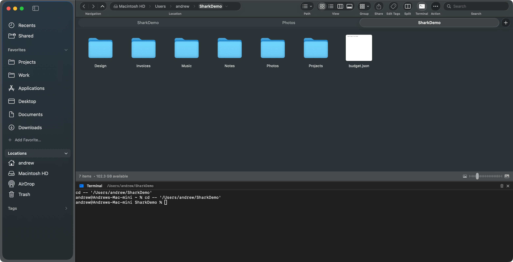
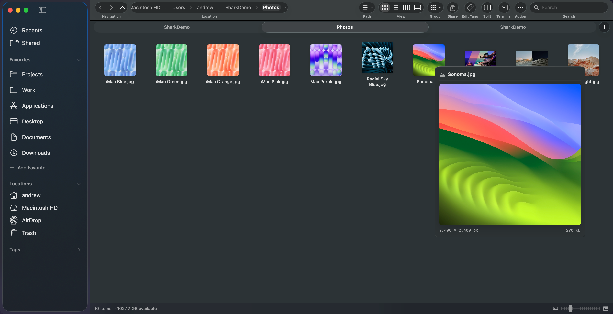
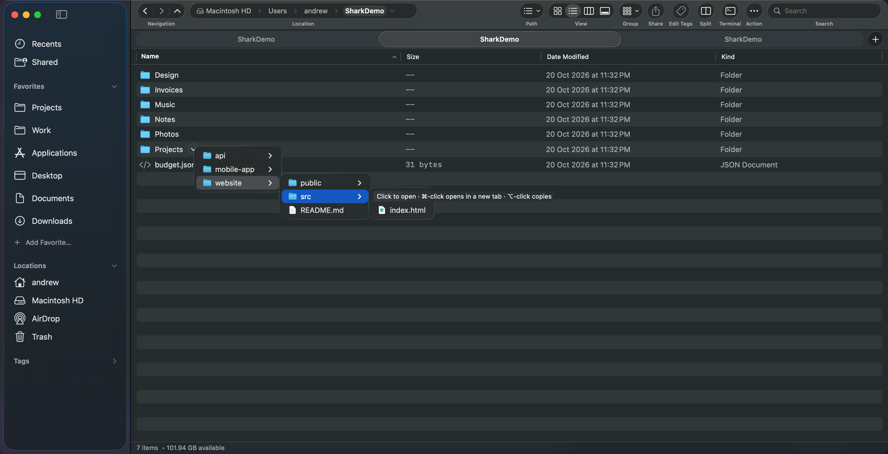

<p align="center">
  
</p>

<h1 align="center">Shark</h1>
<p align="center">A native Mac file manager for people who live in their folders.</p>
<p align="center">macOS 14+ · Apple silicon & Intel · Built with Swift and SwiftUI</p>

Shark brings tabs, split panes, an embedded terminal, and quick previews into a familiar Mac interface. Keep your project folders open, move files between locations, and look inside things without losing your place.

## Four things to try first

### 1. Keep folders side by side

Open folders in tabs, then press **F3** for a second pane. Drag files between the panes to move them, or hold **Option** to copy. Pin the tabs you use all day; Shark restores your session when you return.



### 2. Bring the terminal to your files

Press **F4** to open a real terminal below your files. It follows the active folder, so you can browse to a project and start working from the same window.



### 3. Preview without opening another app

Hover over a file to see what's inside: images, text, documents, video, and audio. Media previews have playback controls. Adjust the delay, require Shift to preview, or turn previews off in **Settings → Previews**.



### 4. Browse deeper without leaving your folder

Hover over a folder and click its little arrow to browse a cascading menu of its contents. Keep going into subfolders, then click to open an item. **Command-click** a folder to open it in a new tab; **Option-click** to copy an item for pasting elsewhere.



## Get started

Once a release is published, download `Shark-<version>.zip` from this repository's **Releases** page, unzip it, and move **Shark.app** to **Applications**. Public downloads built by the release action are Developer ID signed and notarized.

Open a folder from the sidebar, or press **⌘L**, type a path, and press Return. macOS may ask for access to protected folders such as Documents or Downloads; allow the folders you want to browse.

Shark requires **macOS Sonoma 14 or later**. Liquid Glass chrome is available on macOS 26+; earlier versions use system material fallbacks. On keyboards where the function keys control system features, hold **Fn** when using F3 or F4.

## A few useful keys

| Action | Shortcut |
| --- | --- |
| New tab / reopen a closed tab | ⌘T / ⇧⌘T |
| Enter a folder path | ⌘L |
| Go to the enclosing folder | ⌘↑ |
| Toggle split panes | F3 |
| Toggle terminal | F4 |
| Open the command palette | ⌘K |
| Quick Look selected files | Space |
| Cut / copy / paste | ⌘X / ⌘C / ⌘V |
| Show hidden files | ⇧⌘. |
| Open the inspector | ⌥⌘I |

Prefer the mouse? **Help → Shark Help** lists what clicks, hovering, dragging, and scrolling do in each part of the window. Optional gestures live in **Settings → Mouse**.

## More for everyday work

- **Four views:** icons, details, columns, and gallery.
- **Find your way:** filename filtering, editable paths, favorites, and a command palette.
- **File tools:** batch rename, duplicate, compress, drag and drop, and move to Trash.
- **Inspect files:** sizes, permissions, metadata, and SHA-256 checksums.
- **Make tabs yours:** reorder, pin, lock, color, group, and reopen closed tabs.

## Build from source

Install **Xcode 26 or newer** and select it as your active developer directory. The current source uses the macOS 26 SDK while targeting macOS 14+. From the repository root:

```sh
swift build
swift test
bash scripts/run.sh
```

The run script builds and opens `Shark.app`. Swift Package Manager fetches [SwiftTerm](https://github.com/migueldeicaza/SwiftTerm) for the terminal and [Inject](https://github.com/krzysztofzablocki/Inject) for development hot reload.

For a local universal package:

```sh
scripts/package.sh 0.7.0
```

See [Releasing Shark](docs/RELEASING.md) for GitHub secrets, signing, notarization, and version tags. **Mac App Store distribution needs additional sandbox work**; the current release action publishes direct downloads.

Read the [changelog](CHANGELOG.md) for changes, [product direction](PRODUCT.md) for scope, and [design guide](DESIGN.md) for interface conventions.
