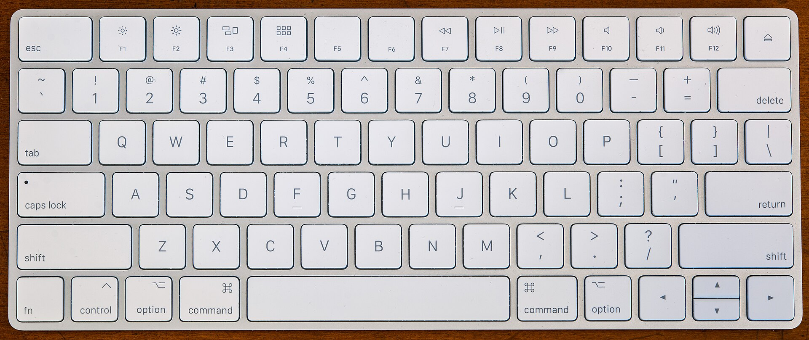

To cut and paste a file on a Mac, select it and press <kbd>⌘C</kbd>, go to the destination folder, then press <kbd>⌥⌘V</kbd> (Option-Command-V). Finder moves the file instead of copying it.

That's the whole trick. The rest of this guide explains why <kbd>⌘X</kbd> doesn't work on files, how to undo a move, and the other ways to move files on macOS.

Photo: Fletcher, <a href="https://creativecommons.org/licenses/by/4.0/" rel="license noopener">CC BY 4.0</a>, via <a href="https://commons.wikimedia.org/wiki/File:Apple_Magic_Keyboard_-_US.jpg" rel="noopener">Wikimedia Commons</a>.

## Step by step: move files with the keyboard

1. In Finder, select the files or folders. <kbd>⌘</kbd>-click to select several, or <kbd>⌘A</kbd> to select everything.
2. Press <kbd>⌘C</kbd>. Nothing visible happens, which is normal.
3. Open the folder you want them in.
4. Press <kbd>⌥⌘V</kbd>.

The files appear in the new folder and disappear from the old one. If a file with the same name is already there, Finder asks whether to keep both, stop, or replace it.

You can also do it from the menu bar. After copying, open the **Edit** menu and hold <kbd>⌥</kbd>. **Paste Item** changes to **Move Item Here**.

## Why Finder has no Cut command for files

On Windows, cutting a file doesn't remove it either. Nothing moves until you paste, and if you never paste, the file stays where it was. Finder makes that explicit: you always copy, and you choose at paste time whether the result is a copy or a move.

The downside is that nothing on screen shows that a file is waiting to move, and the shortcut is hard to discover. That's why "how to cut and paste on Mac" is such a common question from people switching from Windows.

## How to undo a move

Press <kbd>⌘Z</kbd> in Finder, or choose **Edit › Undo Move**. Do it straight after the move for the best result.

## Other ways to move files on a Mac

- **Drag and drop.** Dragging to a folder on the same disk moves the file. Dragging to another disk copies it. Hold <kbd>⌘</kbd> while dragging to force a move, or <kbd>⌥</kbd> to force a copy.
- **Drop onto a tab or sidebar item.** Drop files onto a Finder tab or a sidebar favorite to move them there without opening it.
- **Spring-loaded folders.** Hover a dragged file over a folder and it opens, so you can go several levels deep in one drag.
- **Terminal.** `mv ~/Downloads/report.pdf ~/Documents/` moves a file from the command line.

## Real cut and paste for files with Shark

[Shark](/) is a free Mac file manager that supports <kbd>⌘X</kbd> and <kbd>⌘V</kbd> for files, the way Windows does:

- Cut items look dimmed, so you can see what's ready to move.
- Pasting never replaces an existing file. If an item with that name is already there, Shark refuses the move instead of overwriting it.
- <kbd>⌘Z</kbd> undoes the move.

With split panes (<kbd>F3</kbd>) you can cut from one folder and paste into the other without switching windows.

