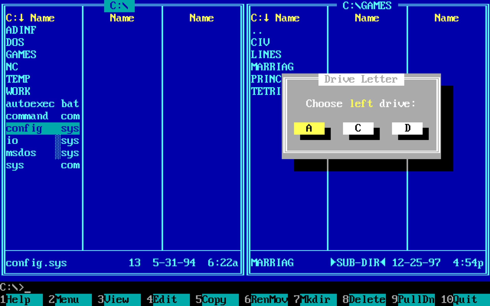

Finder has no split screen. Each window or tab shows one folder, so copying files between two folders means juggling windows. Here are four ways to see two folders side by side on a Mac, from free built-in options to a dual-pane file manager.

## 1. Tile two Finder windows

1. Open a Finder window (<kbd>⌘N</kbd>) and go to the first folder.
2. Open a second window (<kbd>⌘N</kbd>) and go to the other folder.
3. Hover over the green button at the top left of the first window and choose **Tile Window to Left of Screen**. Do the same with the second window and choose the right side.

On macOS 15 and later you can also drag a window to the left or right edge of the screen to tile it, or press <kbd>Fn</kbd>-<kbd>Control</kbd>-<kbd>←</kbd> and <kbd>Fn</kbd>-<kbd>Control</kbd>-<kbd>→</kbd>.

Then drag files from one window to the other. Within the same disk, dragging moves a file. To another disk, it copies. Hold <kbd>⌥</kbd> to copy instead of move, or <kbd>⌘</kbd> to move instead of copy.

**Downside:** two separate windows, each with its own toolbar, that you have to set up again every time.

## 2. Full-screen Split View

Hover over the green button and choose **Full Screen › Left of Screen** (the wording varies by macOS version), then pick a second Finder window for the other half. This hides everything else, which helps if you're focused on sorting files. You leave Split View with <kbd>Esc</kbd> or the green button.

## 3. Finder tabs

Finder tabs (<kbd>⌘T</kbd>) keep several folders in one window, but you see only one at a time. You can drag a file onto a tab to move it there, which helps a little. It's still not side by side.

## 4. Use a dual-pane file manager

A dual-pane, or two-panel, file manager shows two folders in one window. These are often called commanders, after Norton Commander for DOS and later Total Commander for Windows.

Screenshot: Yuri Samoilov, <a href="https://creativecommons.org/licenses/by/2.0/" rel="license noopener">CC BY 2.0</a>, via <a href="https://commons.wikimedia.org/wiki/File:Dos_with_Norton_Commander_(45688271474).png" rel="noopener">Wikimedia Commons</a>.

In [Shark](/), press <kbd>F3</kbd> to split the current tab:

- Each pane keeps its own folder and its own view, so one side can be a list and the other icons.
- File actions such as copy, paste and Trash apply to the pane you're working in.
- Drag files across to the other pane to move or copy them, or cut with <kbd>⌘X</kbd> on one side and paste with <kbd>⌘V</kbd> on the other.
- The split is saved with the tab and comes back when you reopen Shark.

Press <kbd>F3</kbd> again to close the split. On some keyboards you need to hold <kbd>Fn</kbd> with the function keys.

Other dual-pane file managers for Mac include ForkLift, Commander One, Marta, Nimble Commander and Path Finder, and QSpace goes up to four panes. See our [comparison of Finder alternatives](/guides/finder-alternatives-mac/) for prices and features.

## Which should you use?

If you only need two folders now and then, tiling two Finder windows is free and works well. If you do it every day, a dual-pane file manager saves you setting it up each time. Shark is free and looks like Finder, so it's an easy one to try.
