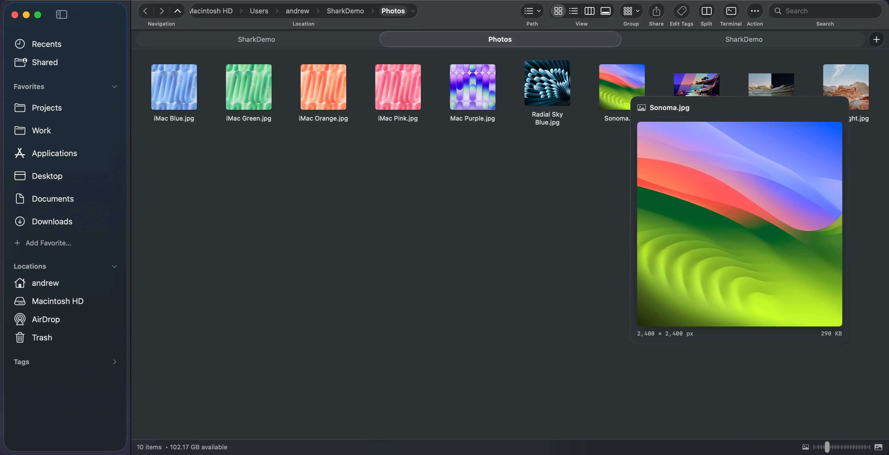
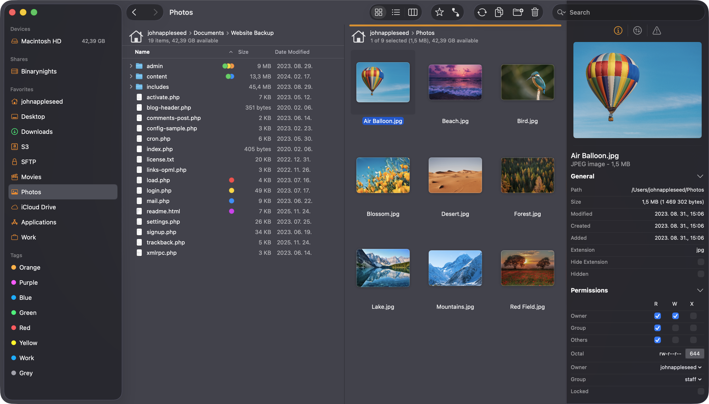
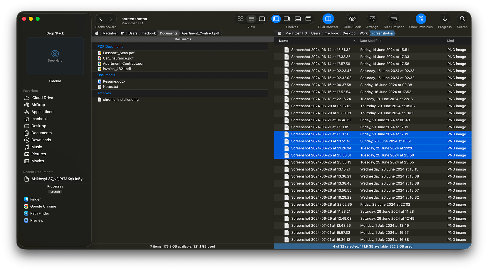
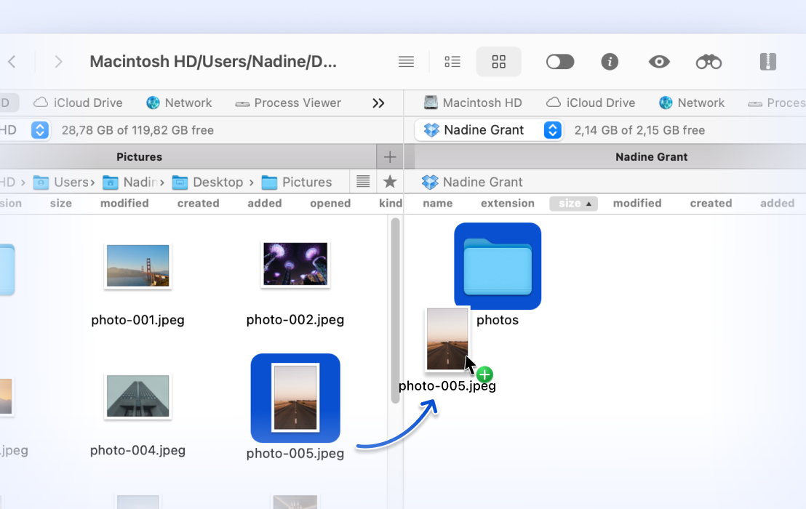
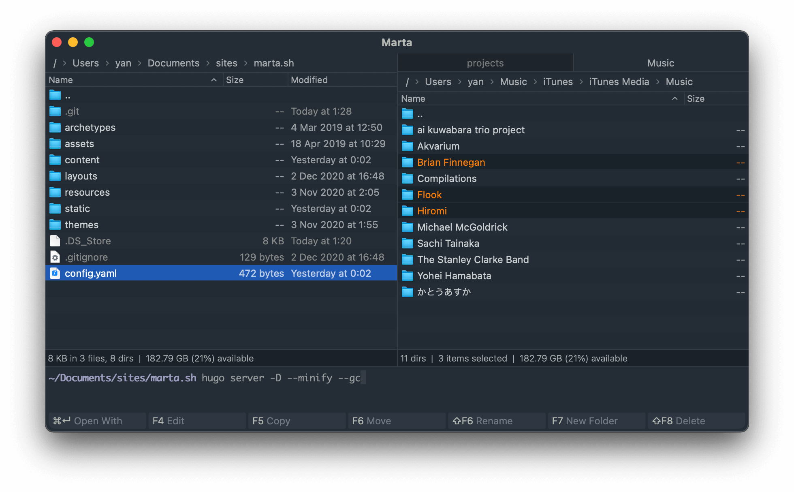
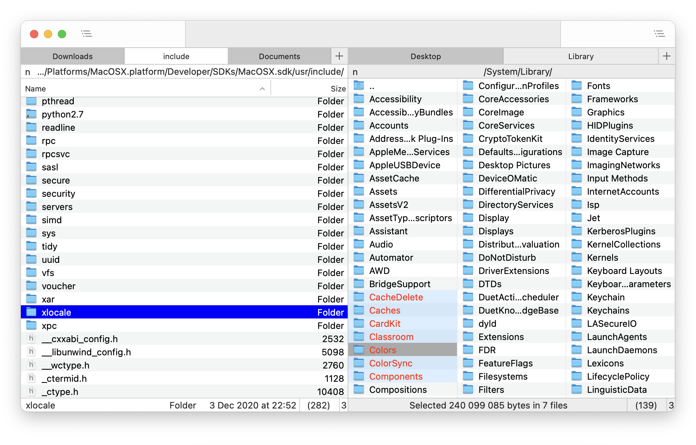
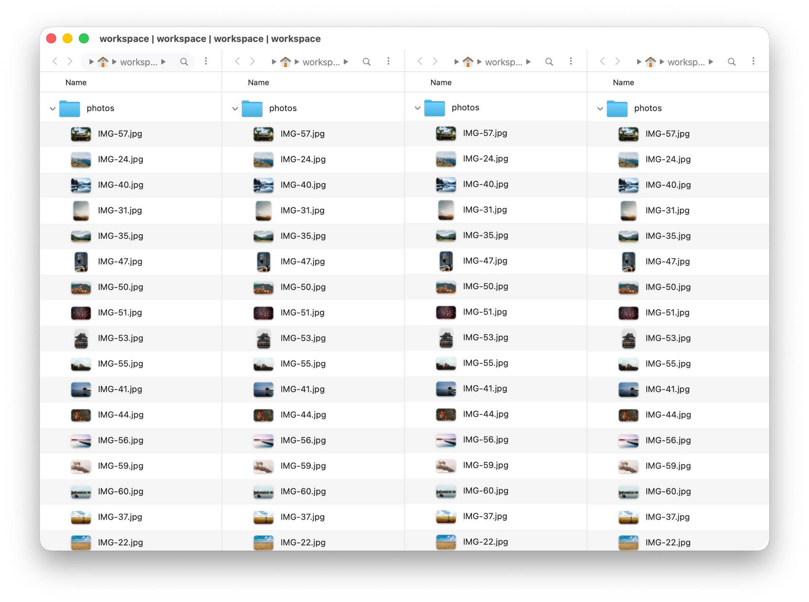

Finder is fine for opening a file now and then. If you move files all day, it starts to get in the way. You can't see two folders side by side in one window, you can't cut and paste a file with ⌘X, and typing a path means opening a separate dialog first.

A Finder alternative is a file manager you run instead of Finder, or next to it. We looked at the seven we think are worth trying in 2026. All of them run alongside Finder, and most have a free version or trial, so trying one costs nothing.

## Quick comparison

| App | Price | Two panes | Built-in terminal | Remote servers | Open source |
| --- | --- | --- | --- | --- | --- |
| [Shark](#shark) | Free | Yes | Built in | No | Yes |
| [ForkLift 4](#forklift-4) | From $19.95 | Yes | — | Yes | No |
| [Path Finder](#path-finder) | Subscription or license, 30-day trial | Yes | — | Dropbox | No |
| [Commander One](#commander-one) | Free, Pro $29.99 | Yes | — | Pro | No |
| [Marta](#marta) | Free | Yes | Built in | — | No |
| [Nimble Commander](#nimble-commander) | Free | Yes | Built in | FTP, SFTP, WebDAV | Yes |
| [QSpace](#qspace) | From $27.99 + extensions | Up to 4 | Opens Terminal | With extension | No |

Prices are the regular prices on each developer's site in October 2026. A dash means the developer's site doesn't list that feature. Sales and versions change, so check before you buy.

## What to look for in a Finder replacement

- **Two panes.** Two folders side by side in one window make moving files one drag.
- **Tabs that remember.** Tabs you can reorder and pin, and that come back after a restart.
- **An editable path bar.** Type or paste a path and go straight there.
- **Keyboard flow.** A command palette, or shortcuts for everything you do often.
- **A terminal close by.** If you write code, a shell in the folder you're looking at saves a lot of `cd`.
- **Native feel.** Quick Look, drag and drop, Trash and system sharing should work the way they do in Finder.
- **Remote and cloud access.** Only matters if you need SFTP, S3 or similar inside the file manager.

## Shark

[Shark](/) is a free, open source (Apache 2.0) file manager built with Swift and SwiftUI. Full disclosure: we make it. It keeps Finder's look and adds what Windows File Explorer users tend to miss.

**Standout features**

- Folder tabs you can pin, lock, color and save as named groups, with session restore
- Side-by-side panes (<kbd>F3</kbd>), each with its own folder and view
- A real terminal drawer that starts in your current folder (<kbd>F4</kbd>) and keeps running when you hide it
- A typed path bar (<kbd>⌘L</kbd>), a command palette (<kbd>⌘K</kbd>) and cut and paste with <kbd>⌘X</kbd> and <kbd>⌘V</kbd>
- Hover previews for images, video, audio, text and documents
- An optional File Explorer style folder tree, batch rename with a preview, and undo for file operations

**Limits:** Shark is still in alpha, so expect rough edges. It has no remote-server or cloud-account client, no folder sync, and it can create ZIP files but not browse inside archives.

**Price:** free. macOS 14 or later.

**Best for:** people coming from Windows, and anyone who wants Finder's look with more power, at no cost.

## ForkLift 4

Screenshot: BinaryNights, from <a href="https://binarynights.com/" rel="noopener">binarynights.com</a>.

ForkLift is a polished dual-pane file manager that doubles as a file transfer client. It is the strongest choice here for remote work.

**Standout features**

- Connects to SFTP, FTP, WebDAV, Amazon S3, Backblaze B2, Google Drive, OneDrive, Dropbox, SMB, AFP and NFS, with several servers open at once
- One-way or two-way folder sync, locally or between servers
- Edit remote files in your own editor, with changes uploaded on save
- Quick Open for commands and favorites, multi-rename presets, an activity view and themes

**Limits:** paid, and the remote features are more than many people need.

**Price:** $19.95 for a single user, $29.95 for a family. The license is lifetime and includes one year of updates.

**Best for:** developers and designers who move files between their Mac and servers every day.

## Path Finder

Screenshot: Cocoatech, from <a href="https://cocoatech.io/" rel="noopener">cocoatech.io</a>.

Path Finder from Cocoatech is one of the oldest Finder replacements and has the most features of any app here.

**Standout features**

- A dual-pane browser with one-click copying between panes
- A Drop Stack that holds files while you find where they should go
- Folder compare and sync, batch rename, a size browser and secure delete
- Dropbox integration and browsing of iPhones connected over USB

**Limits:** paid, and the interface is busier than Finder's.

**Price:** a subscription or a license key, with a 30-day free trial.

**Best for:** power users who want every tool in one window.

## Commander One

Screenshot: Electronic Team, from <a href="https://commander-one.com/" rel="noopener">commander-one.com</a>.

Commander One is a classic two-panel file manager. Its site says Total Commander's author, Christian Ghisler, approved it as the Total Commander for Mac.

**Standout features**

- Two panels with unlimited tabs and an operations queue
- Browse and edit inside ZIP, RAR, 7Z and TAR archives
- In the Pro version: Amazon S3, Google Drive, Dropbox, OneDrive, FTP, SFTP and WebDAV, plus encryption of files stored online
- Access to iPhone, Android and MTP devices over USB

**Limits:** the best features are in Pro, and the interface looks more Windows than Mac.

**Price:** a free version, with Pro at $29.99 for one Mac.

**Best for:** people who used Total Commander on Windows.

## Marta

Screenshot: Marta, from <a href="https://marta.sh/" rel="noopener">marta.sh</a>.

Marta is a free, native, keyboard-first file manager written in Swift.

**Standout features**

- Two panes, tabs and an actions panel (<kbd>⇧⌘P</kbd>) to run any command
- A built-in terminal that stays in sync with the current folder
- Opens ZIP, RAR, 7Z, TAR, ISO and more like folders
- Configuration in a text file, five themes and a Lua plugin API

**Limits:** settings live in a configuration file rather than a settings window, which suits some people more than others. Its site lists no remote connections.

**Price:** free, supported by donations.

**Best for:** keyboard-driven users who like tuning their tools.

## Nimble Commander

Screenshot: Magnumbytes, from <a href="https://magnumbytes.com/" rel="noopener">magnumbytes.com</a>.

Nimble Commander is a free, open source, dual-pane file manager in the Norton Commander tradition, written mostly in C++ for speed.

**Standout features**

- Keyboard shortcuts for more than a hundred actions
- A built-in terminal that stays in sync with the panels
- FTP, SFTP and WebDAV connections, a hex and text viewer for huge files, and batch rename
- An admin mode for root access without restarting the app

**Limits:** the design is classic rather than modern, and it is aimed at technical users.

**Price:** free.

**Best for:** developers and system administrators who like the orthodox two-panel layout.

## QSpace

Screenshot: QSpace, from <a href="https://qspace.awehunt.com/" rel="noopener">qspace.awehunt.com</a>.

QSpace looks close to Finder but can show up to four folders at once, in 12 layouts.

**Standout features**

- 12 layouts, from one pane to four
- An address bar you can type into, with auto-completion
- One-click file hashes (MD5, SHA-256 and more) and optional Windows key bindings
- Paid extensions for server connections, archives, batch rename and a stash shelf

**Limits:** the base price leaves out several features that are sold as extensions.

**Price:** $27.99 on the Mac App Store or $29.99 for QSpace Pro (with a 30-day trial). Extensions cost extra.

**Best for:** people who want three or four folders on screen at once.

## Try Finder's hidden options first

Before you install anything, turn these on. They may be enough:

- **View › Show Path Bar** (<kbd>⌥⌘P</kbd>) and **View › Show Status Bar** (<kbd>⌘/</kbd>)
- **Go › Go to Folder** (<kbd>⇧⌘G</kbd>) to type a path
- <kbd>⌘C</kbd> then <kbd>⌥⌘V</kbd> to move a file. See [how to cut and paste files on a Mac](/guides/cut-and-paste-files-mac/).
- Finder tabs with <kbd>⌘T</kbd>

If you still miss two panes, a terminal in the folder, or a path bar you can type into, pick from the list above. Need two panes most? Read [how to view two folders side by side](/guides/dual-pane-file-manager-mac/). Coming from Windows? Start with [File Explorer habits on a Mac](/guides/windows-file-explorer-on-mac/).
