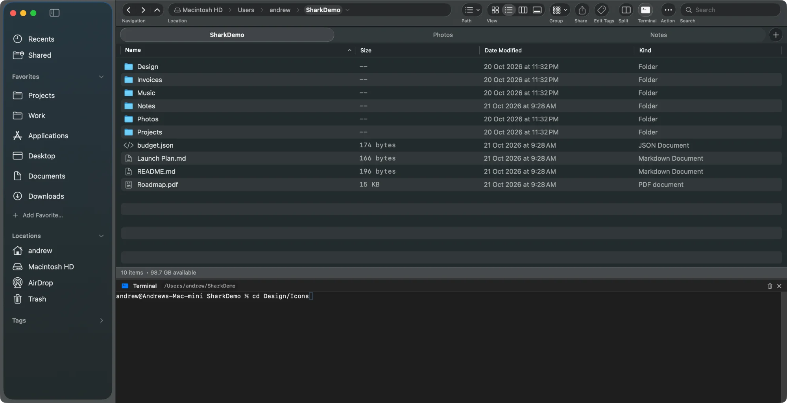

On Windows you can type `cmd` into File Explorer's address bar to open a prompt in that folder. macOS has no single button for it, but there are several quick ways to open Terminal in the current folder.

## 1. Right-click: New Terminal at Folder

Right-click (or <kbd>Control</kbd>-click) a folder in Finder and choose **Services › New Terminal at Folder**. Terminal opens with that folder as its working directory. **New Terminal Tab at Folder** does the same in a new tab.

If you don't see it:

1. Open **System Settings › Keyboard**.
2. Click **Keyboard Shortcuts…** and choose **Services**.
3. Under **Files and Folders**, turn on **New Terminal at Folder**.

While you're there, you can give it a keyboard shortcut.

## 2. Drag the folder into Terminal

Type `cd ` (with a space) in Terminal, then drag a folder from Finder into the window. Terminal fills in the full path, spaces escaped. Press Return.

Tip: the small folder icon in a Finder window's title bar is draggable too, so you can drag the folder you're inside without going up a level. On recent macOS versions, hover over the folder name in the title bar first to make the icon appear.

You can also drag a folder onto the Terminal icon in the Dock to open a new window there.

## 3. Copy the path from Finder

Select a folder and press <kbd>⌥⌘C</kbd>, or right-click it, hold <kbd>⌥</kbd> and choose **Copy as Pathname**. In Terminal, type `cd `, paste the path in quotes, and press Return:

```sh
cd "/Users/you/Documents/My Project"
```

## 4. Add a Terminal button to the Finder toolbar

Hold <kbd>⌘</kbd> and drag the Terminal app from **Applications › Utilities** onto the Finder toolbar. Now you can drag any folder onto that button to open Terminal there.

## 5. Use a terminal inside your file manager

Switching apps gets old if you live in the terminal. [Shark](/) has a built-in terminal drawer:

- Press <kbd>F4</kbd> and a real interactive shell opens below your files, in the folder you're browsing.
- It's a full terminal, with history, Tab completion, <kbd>Control</kbd>-C and full-screen programs like `vim` and `top`.
- The shell keeps running when you hide the drawer or switch tabs, so a long command isn't lost.
- Browsing to another folder never types into it.
- Prefer macOS Terminal? Right-click a folder and choose **Open in Terminal**.



Marta and Nimble Commander also have built-in terminals. See our [comparison of Finder alternatives](/guides/finder-alternatives-mac/).

## The reverse: open Finder from Terminal

Run `open .` to open the current folder in Finder, `open -R file.txt` to show a file in Finder, or `open -a Shark .` to open the folder in Shark.
