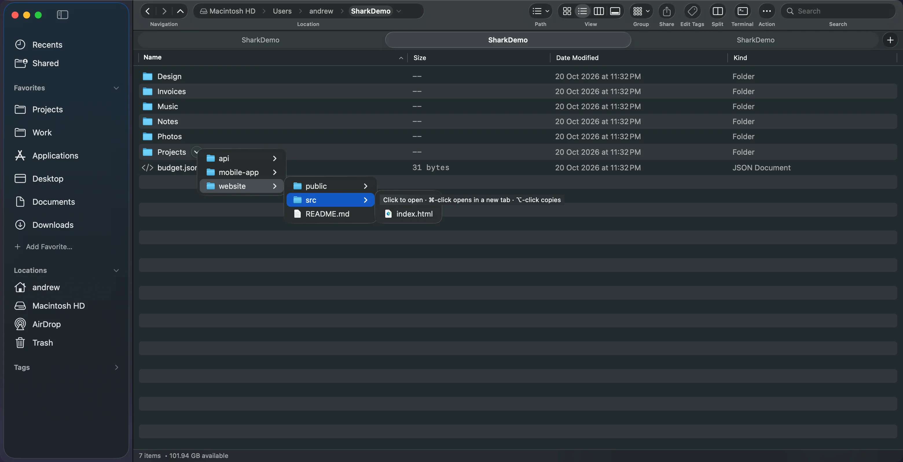
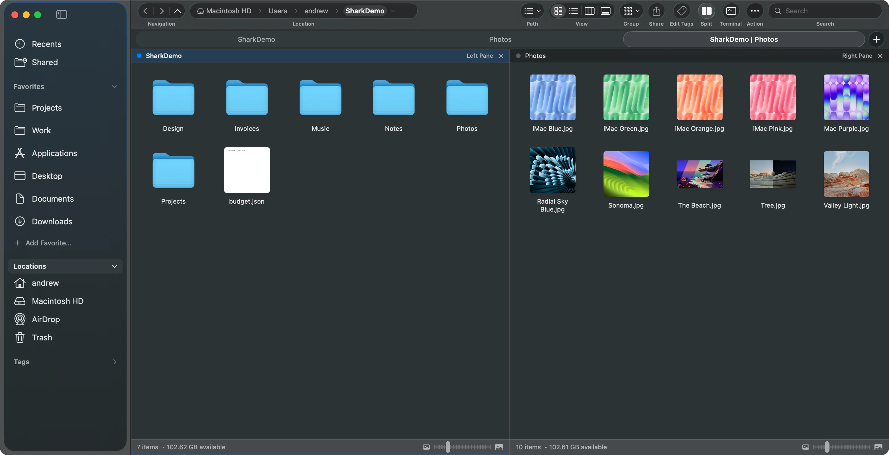
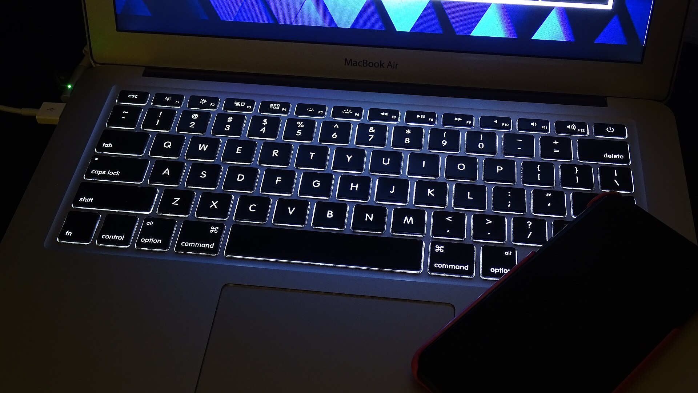

There is no File Explorer on a Mac. The Mac version is **Finder**: the blue face icon at the left end of the Dock. Finder does the same job, but it hides much of what Windows users rely on, and some of it isn't there at all.

Here's how to get each File Explorer habit back, first in Finder and then with [Shark](/), a free file manager for Mac built around those habits.

## The address bar

In File Explorer you click the address bar and type a path.

- **Finder:** press <kbd>⇧⌘G</kbd> (**Go › Go to Folder**), type or paste the path, and press Return. Paths start with `/`, like `/Users/you/Documents`, and `~` means your home folder. To keep the path visible, turn on **View › Show Path Bar** (<kbd>⌥⌘P</kbd>). You can click that bar but not type in it.
- **Shark:** the location bar works like File Explorer's. Press <kbd>⌘L</kbd>, type a path, and press Return. Click any parent folder to jump to it, or the arrow beside it to browse its subfolders.

## Cut and paste

Windows: <kbd>Ctrl</kbd>+<kbd>X</kbd>, then <kbd>Ctrl</kbd>+<kbd>V</kbd>.

- **Finder:** copy with <kbd>⌘C</kbd>, then press <kbd>⌥⌘V</kbd> to move the file instead of copying it. Cut is greyed out for files. Our guide on [cutting and pasting files on a Mac](/guides/cut-and-paste-files-mac/) covers it in detail.
- **Shark:** <kbd>⌘X</kbd> and <kbd>⌘V</kbd> work as they do on Windows. Cut items look dimmed until you paste them.

## The status bar

File Explorer shows the item count and the size of your selection at the bottom of the window.

- **Finder:** **View › Show Status Bar** (<kbd>⌘/</kbd>) shows the item count and free space. For a selection's total size, press <kbd>⌃⌘I</kbd> (Get Summary Info).
- **Shark:** the status bar shows the item count, filtered results, the total size of the selection and free disk space.

## The navigation pane and folder tree

File Explorer's navigation pane is an expandable tree of folders.

- **Finder:** the sidebar is a list of favorites, not a tree. List view (<kbd>⌘2</kbd>) lets you expand folders in place with their disclosure triangles, which is the closest you'll get.
- **Shark:** turn on the File Explorer folder tree option to replace Locations and Tags in the sidebar with an expandable tree that follows the folder you're in.

## Tabs and two folders side by side

Windows 11 added tabs to File Explorer. Many power users also run QTTabBar or a two-panel file manager.

- **Finder:** has tabs (<kbd>⌘T</kbd>). To see two folders at once, tile two windows.
- **Shark:** tabs you can pin, lock, color and save as groups, plus split panes (<kbd>F3</kbd>) so two folders share one window. See [how to view two folders side by side](/guides/dual-pane-file-manager-mac/).

## Windows keyboard shortcuts on a Mac

The Mac's <kbd>⌘</kbd> (Command) key does most of what <kbd>Ctrl</kbd> does on Windows. <kbd>⌥</kbd> (Option) is the Mac's <kbd>Alt</kbd>.

Photo: TheumasNL, <a href="https://creativecommons.org/licenses/by-sa/4.0/" rel="license noopener">CC BY-SA 4.0</a>, via <a href="https://commons.wikimedia.org/wiki/File:MacBook_Air_keyboard_1.jpg" rel="noopener">Wikimedia Commons</a>.

| In File Explorer | In Finder | In Shark |
| --- | --- | --- |
| <kbd>F2</kbd> rename | Select, then Return | <kbd>F2</kbd> or Return |
| <kbd>Delete</kbd> to Recycle Bin | <kbd>⌘⌫</kbd> to Trash | <kbd>⌘⌫</kbd> to Trash |
| <kbd>Ctrl</kbd>+<kbd>Shift</kbd>+<kbd>N</kbd> new folder | <kbd>⇧⌘N</kbd> | <kbd>⇧⌘N</kbd> |
| <kbd>F5</kbd> refresh | Updates on its own | Updates on its own |
| <kbd>Alt</kbd>+<kbd>↑</kbd> up a folder | <kbd>⌘↑</kbd> | <kbd>⌘↑</kbd>, or double-click empty space |
| <kbd>Alt</kbd>+<kbd>←</kbd> back | <kbd>⌘[</kbd> | <kbd>⌘[</kbd>, or the mouse back button |
| <kbd>Ctrl</kbd>+<kbd>L</kbd> address bar | <kbd>⇧⌘G</kbd> | <kbd>⌘L</kbd> |
| <kbd>Ctrl</kbd>+<kbd>F</kbd> search | <kbd>⌘F</kbd> | <kbd>⌘F</kbd> filters the folder |
| Show hidden files | <kbd>⇧⌘.</kbd> | <kbd>⇧⌘.</kbd> |
| Open Command Prompt here | Right-click › Services › New Terminal at Folder | <kbd>F4</kbd> opens a terminal in the folder |

More on that last one: [how to open Terminal in the current folder](/guides/open-terminal-in-folder-mac/).

## Opening files: Return renames

Double-click works the same as on Windows. One difference catches everyone out: in Finder, pressing **Return** renames a file instead of opening it. To open it from the keyboard, press <kbd>⌘↓</kbd> or <kbd>⌘O</kbd>.

## So which should you use?

Turn on the path bar and status bar in Finder, learn <kbd>⇧⌘G</kbd> and <kbd>⌥⌘V</kbd>, and you'll close most of the gap. If you still miss File Explorer, try Shark. It's free, open source, and made by someone who moved from Windows and missed the same things. For other options, see our [comparison of Finder alternatives](/guides/finder-alternatives-mac/).
